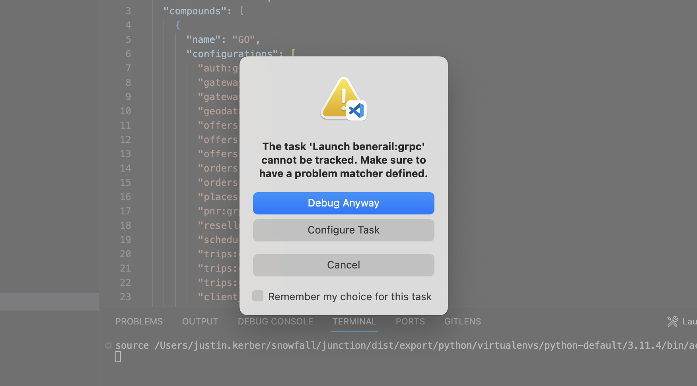

# Visual Studio Code

:::warning
This guide is for getting your VS Code workspace set up for Backend development. For Frontend development tips please see [Hub UI (Front-end)](../../projects/junction/hub/hub-frontend.md)
:::

## Automated Setup
___

:::info
Setting up your VS Code workspace for Junction will soon be automated! This will be included in the dev tools we are currently building. Stay tuned!
:::

## Manual Setup
___

Before you start, you need to export a Python virtual environment from Pants, as well as the Python code generated from our protocol buffers.

```shell
pants export
pants export-codegen protobuf/::
```

You'll need to do this again whenever `vendor/constraints.txt` or a file in
`protobuf/` changes or your environment will quickly become outdated.

:::tip

You can use this extension [File Watcher](https://marketplace.visualstudio.com/items?itemName=appulate.filewatcher) to do this automatically.
See [Recommended Extension Settings](#extensions-settings) section for setting this up.
:::

### Configure Python Interpreter

Once we have our environment exported, we need to configure VS Code to use the proper python interpreter.
:::note
*You'll need the Python extension installed if you don't already. See [required extensions](#required-extensions) section below*
:::

Locate the exported environment in `dist/export/python/virtualenvs/python-default/` and note the python version or just grab the path printed out by pants after running the export command.

Open (or create) the `.vscode` folder in your workspace. If creating it for the first time, make sure to add it to your global git ignore so you don't push it to the repo.

Open (or create) the `settings.json` file in the `.vscode` folder in your workspace, and add the following to it:

```json
  "python.terminal.activateEnvironment": true,
  "python.defaultInterpreterPath": "${workspaceFolder}/dist/export/python/virtualenvs/python-default/3.11.4/bin/python",
  "python.analysis.extraPaths": [
    "${workspaceFolder}/python",
    "${workspaceFolder}/dist/codegen/python",
    "${workspaceFolder}/bash",
    "${workspaceFolder}/protobuf",
    "${workspaceFolder}/openapi"
  ],
  "terminal.integrated.env.osx": {
    "PYTHONPATH": "${workspaceFolder}/python:${workspaceFolder}/dist/codegen/python:${workspaceFolder}/protobuf:${workspaceFolder}/openapi"
  },
```
:::warning
Put the path for your exported environment in the `python.defaultInterpreterPath` setting if different. Make sure to update this path if a new environment is created.
:::

Open a new terminal window and you should see it activate the python environment.

### Required Extensions
:::info
The following extensions are required to be installed for the required settings to apply and for running/debugging our services.
:::
- [Python](https://marketplace.visualstudio.com/items?itemName=ms-python.python)
- [Python Debugger](https://marketplace.visualstudio.com/items?itemName=ms-python.debugpy)

### Recommended Extensions
:::info
The following extensions are entirely optional but recommened for improving your developer experience working with the Junction monorepo
:::
- [vscode-proto3](https://marketplace.visualstudio.com/items?itemName=zxh404.vscode-proto3)
  > Provides support for developing with protobufs. Features include things like syntax highlighting, validation, code snippets, code completion, etc.
compilation
- [Black Formatter](https://marketplace.visualstudio.com/items?itemName=ms-python.black-formatter)
  > Provides support for the black formatter for python files
- [EditorConfig for VS Code](https://marketplace.visualstudio.com/items?itemName=EditorConfig.EditorConfig)
  > This will apply the settings in the `.editorconfig` file to your workspace
- [File Watcher](https://marketplace.visualstudio.com/items?itemName=appulate.filewatcher)
  > Allows you to perform actions when a file/folder changes. This is useful for automating the pants commands and more
- [Redocly OpenAPI](https://marketplace.visualstudio.com/items?itemName=Redocly.openapi-vs-code)
  > Provides support for Redocly OpenAPI. Our APIs use Redocly and with this extension you get many things including a preview option
- [Python Environment Manager](https://marketplace.visualstudio.com/items?itemName=donjayamanne.python-environment-manager)
  > Provides the ability to view and manage all of your Python environments & packages from a single place within your workspace
- [Redis](https://marketplace.visualstudio.com/items?itemName=cweijan.vscode-redis-client)
  > Provides the ability to connect to a Redis database and a nice display to view and modify data in the database within your workspace. You can use this to easily connect to the local redis instance running in our docker container!
- [Docker](https://marketplace.visualstudio.com/items?itemName=ms-azuretools.vscode-docker)
  > Provides support for Docker to build, manage and deploy containers within your workspace
- [HashiCorp Terraform](https://marketplace.visualstudio.com/items?itemName=HashiCorp.terraform)
  > Provides support for developing with Terraform files. Features include things like syntax highlighting, formatting, etc. I use this to create a file association (see [Recommended Extension Settings](#extensions-settings)) for our `.nomad` files
- [Even Better TOML](https://marketplace.visualstudio.com/items?itemName=tamasfe.even-better-toml)
  > Provides support for developing with TOML files. Features include things like syntax highlighting, validation, formatting, etc
- [Draw.io Integration](https://marketplace.visualstudio.com/items?itemName=hediet.vscode-drawio)
  > Provides support for Draw.io
- [Draw.io Integration: Mermaid plugin](https://marketplace.visualstudio.com/items?itemName=nopeslide.vscode-drawio-plugin-mermaid)
  > Plugin for the Draw.io extension that provides support for Mermaid
- [Markdown Preview Mermaid Support](https://marketplace.visualstudio.com/items?itemName=bierner.markdown-mermaid)
  > Adds Mermaid diagram and flowchart support inside markdown files when previewing

### Recommended Settings
:::info
The following settings are entirely optional but recommened for improving your developer experience working with the Junction monorepo
:::
#### General Settings:
- **Format on Save** - this will turn on auto formatting when you save a file for all files (some file types I don't recommend this for and turn off. See file type settings below)
- **Insert Final Newline** - this will auto insert a newline at the end of a file after you save it. All our files in the repo expect a new line at the end
```json
  "editor.formatOnSave": true,
  "files.insertFinalNewline": true
```

#### File Type Settings:
- **File Associations** - this will tell VS Code to associate some file type with another type and is handy for getting syntax highlighting and such for some our files (like `BUILD` & `.nomad` files)
- **proto3** - this will turn off auto formatting on save for `protobuf` files. The auto formatting for these files doesn't quite line up with what's expected so I recommend turning this off; formatting these files is pretty straightforward
- **json** - this will turn off auto formatting on save for `json` files and set the tab size to 2. The auto formatting for json files doesn't quite line up with what's expected and will go crazy on our openapi files
```json
  "files.associations": {
    "BUILD": "shellscript",
    "*.nomad": "terraform"
  },
  "[proto3]": {
    "editor.formatOnSave": false
  },
  "[json]": {
    "editor.formatOnSave": false,
    "editor.tabSize": 2
  }
```

#### Extensions Settings:
- **Black Formatter** - this will set the default formatter for python files to black
- **vscode-proto3** - this tells the vscode-proto3 extension where to look for `protobuf` files
- **File Watcher** - this will create some file watchers and actions for when a `protobuf` file changes, a new package is added to `requiements.txt`, or `constraints.txt` is modified. It also specifies the bash shell to use (if you dont use zsh please change this to what you use)
- **Redocly OpenAPI** - this sets up the Redocly OpenAPI extension for use in your workspace. You will need to get your own API key for the live documentation preview feature (which is the main reason I recommend this extension). To obtain the key, [first create a free Redocly account](https://app.redocly.com/signup), then [generate a personal API key for it](https://redocly.com/docs/settings/personal-api-keys/)
```json
  "[python]": {
    "editor.defaultFormatter": "ms-python.black-formatter"
  },
  "protoc": {
    "options": [
      "--proto_path=${workspaceFolder}/protobuf"
    ]
  },
  "filewatcher.isClearStatusBar": true,
  "filewatcher.shell": "/bin/zsh",
  "filewatcher.autoClearConsole": true,
  "filewatcher.commands": [
    {
      "match": "\\.proto*",
      "isAsync": true,
      "cmd": "cd '${workspaceRoot}'; pants export-codegen protobuf/::",
      "event": "onFileChange"
    },
    {
      "match": "vendor/requirements.txt",
      "isAsync": true,
      "cmd": "cd '${workspaceRoot}'; pants generate-lockfiles --resolve=python-default",
      "event": "onFileChange",
    },
    {
      "match": "vendor/constraints.txt",
      "isAsync": true,
      "cmd": "cd '${workspaceRoot}'; pants export",
      "event": "onFileChange"
    }
  ],
  "redoclyOpenAPI.api.key": "",
  "redoclyOpenAPI.api.region": "us",
  "redoclyOpenAPI.trace.server": "messages"
```

:::tip
Settings for VS Code can apply to just the current workspace or to all workspaces based on your preference. Having a `settings.json` file in the `.vscode` folder withing your workspace will have the effect of only applying those settings to your current workspace. Modifying the `settings.json` file found in the installation location of VS Code will have the effect of applying those settings to ALL workspaces.
:::

## Debugging Our Services
:::note
*You'll need the Python Debugger extension installed if you don't already. See [required extensions](#required-extensions) section above*
:::

:::info
**Creating the launch/task configurations for our services will soon be automated! This will be included in the dev tools we are building. It will parse all the Junction services, create all the launch/task configurations for every service, and also create logical groupings for you to launch services together! Stay tuned!**
:::

Running and debugging our services in VS Code uses [debugpy](https://github.com/microsoft/debugpy) in order to get the debugger to connect to our python services.

This works by launching the service using using the bash the script `/bash/run-debugpy.sh` and running the service as a VS Code Task. The service will be running via `debugpy`, will open a connection on the specfied port, and wait for the corresponding launch configuration that uses `debugpy` to connect to the running python service on that port.

**The following workspace json files are used to run our services:**

> `.vscode/launch.json` - this file stores the debugging configuration information for your workspace. See [VSCode Launch Configuration docs](https://code.visualstudio.com/Docs/editor/debugging#_launch-configurations) for more info on launch configurations.

> `.vscode/tasks.json` - this file stores the task configurations for your workspace. See [VSCode Tasks docs](https://code.visualstudio.com/docs/editor/tasks) for more info.

### Launch/Task Templates
:::info
The following are templates that you can use to create a new launch configuration for a Junction service

Replacement value descriptions:
- **`service_name`** - this is the name of your service _(ex: offers, benerail, client_api)_
- **`paramater`** - this is the command sent to your service _(ex: grpc, http, import, simple-offers)_
- **`port`** - this is the port `debugpy` will use to connect VS Code to your service. You can use any port you want for this. Debugpy recommends 5678, so I would recommend just starting at that and incrementing it by 1 for each service launch configuration you create
- **`main_path`** - this will be the **relative** path to the main.py file for your service _(ex: python/snowfall/service/authentication/main.py)_
- **`module_name`** - this will be the python module for your service _(ex: snowfall.service.authentication.main)_
:::
#### Launch Configuration (`.vscode/launch.json`)
> Add the following to the `"configurations"` section in the `launch.json` file, while replacing `service_name` & `paramater` with the proper values for your service
```json
{
  "name": "{service_name}:{paramater}",
  "type": "debugpy",
  "request": "attach",
  "connect": {
    "host": "localhost",
    "port": 5678
  },
  "justMyCode": false,
  "preLaunchTask": "Launch {service_name}:{paramater}",
  "postDebugTask": "Terminate {service_name}:{paramater}"
}
```

#### Task Configurations (`.vscode/tasks.json`)
> Add the following to the `"tasks"` section in the `tasks.json` file, while replacing `service_name`, `paramater`, `port` (this will be the port debugpy will use to connect, and needs to be the same as the port specified in the corresponding launch config), `main_path`, & `module_name` with the proper values for your service.

:::warning
Do not change `${workspaceFolder}` or `${config:python.defaultInterpreterPath}`, these are used to automatically pick up the path to your workspace as well as the default interpreter path you set in your `settings.json` file
:::
```json
{
  "label": "Launch {service_name}:{paramater}",
  "type": "shell",
  "command": [
    "bash ${workspaceFolder}/bash/run-debugpy.sh",
    "${config:python.defaultInterpreterPath}",
    "{port}",
    "${workspaceFolder}/{main_path}",
    "{module_name}",
    "{paramater}"
  ],
  "isBackground": true,
  "presentation": {
    "echo": false,
    "reveal": "always",
    "revealProblems": "never",
    "focus": false,
    "panel": "shared",
    "showReuseMessage": false,
    "clear": true
  }
}
{
  "label": "Terminate {service_name}:{paramater}",
  "command": "echo ${input:terminate {service_name} {paramater}}",
  "type": "shell"
}
```

> Add the following to the `"inputs"` section in the `tasks.json` file, while replacing `service_name` & `paramater` with the proper values for your service
```json
{
  "id": "terminate {service_name} {paramater}",
  "type": "command",
  "command": "workbench.action.tasks.terminate",
  "args": "Launch {service_name}:{paramater}"
}
```

### Known 'Issues'
:::note
If you want to try and are able to figure any of these out that would be awesome! Hit me up and/or just update the docs!
:::

#### Tasks problem matcher warning message
> The first time you launch a service you will receive a warning message from VS Code regarding not being able to track the task because no problem matcher is defined (see screenshot below). Having a problem matcher just doesn't apply to how our service run configurations are setup and after many attempts to make one that works, I have unfortunately been unable to solve this one. However, if you select the checkbox 'Remember my choice for this task' it will ignore this warning from then on



#### No reload on change for a running service
> Currently there is no provided support for automatically relaunching a service while it is running and you make a change to it


**And that's it, you should be all set up to develop on & run Junction! Happy Coding!**


