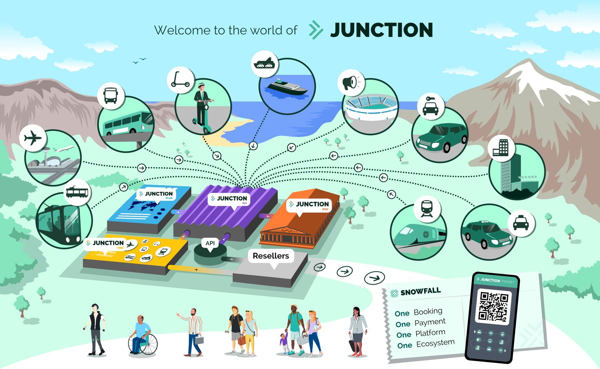

# Welcome

Hello and welcome to Engineering here at Snowfall! :technologist:

Within this section, you'll find various things to set up, install, and read up
on.

We aim to have you ready to be working in your team as soon as we can, please
let us know if any steps are out of date - The best way to do this is to raise a
Merge Request against this project!

## Snowfall

You can read all about Snowfall including why we're here, our values,
our teams, and all the other juicy stuff [here][Snowfall Page]. For now, here's
a TL;DR:

### Why are we here? 🤔

To shape a new golden age of travel.

### What drives us? 🚀

A passion for improving travel; creating and championing technology that
delivers the best possible traveller experience.

### What do we believe? ☀️

Travellers should:

* Have greater choice over their access to & scope of travel
* Have greater control over how they get from A to B
* Be able to travel with confidence, simply & seamlessly

## Junction

Junction is an ecosystem of various services, all aiming to provide the consumer
the most options in the easiest manner for travelling from origin to
destination.

### Go

> Content platform for Junction services, interacting with and exposing various
> third party suppliers

### Hub

> Management system for travel bookings, orders. and payments with a side of an
> in-house booking flow for rail tickets

### Pay

> Service for automating invoice processing, currency exchanges, and other
> financial actions

### One

> Online booking platform for corporate and reseller customers

### SuperApp

> Whitelabel app used to demonstrate the capabilities of Junction as an
> ecosystem

### Plus

> An automated Travel assistant to enhance and simplify travel experience.

## Useful Slack Channels

We're **big** on Slack here; if you can't get an answer in one of our Slack
channels, we're in trouble!

Below are some of the most useful channels and what they represent:

| Channel Link                                                                        | Description                                                                            |
|-------------------------------------------------------------------------------------|----------------------------------------------------------------------------------------|
| [#dev](https://snowfall.slack.com/archives/C0AJ6FGN6)                               | General developer chat                                                                 |
| [#integration-tests](https://snowfall.slack.com/archives/C05EXUNPD8V)               | Discussions around our verify steps                                                    |
| [#junction_x](https://snowfall.slack.com/archives/C05FB96FWRY)                      | A cross-functional effort to onboard our new client [Grupo GEA](https://grupogea.com/) |
| [#junction-api-changelog](https://snowfall.slack.com/archives/C05CWM9H2E6)          | Slackbot for notifying of API spec changes                                             |
| [#junction-backend-devs](https://snowfall.slack.com/archives/C02NL0DA752)           | More focussed backend development conversations                                        |
| [#junction-devops](https://snowfall.slack.com/archives/C04458RS1QW)                 | More focussed DevOps-y conversations                                                   |
| [#junction-go](https://snowfall.slack.com/archives/C0253RGDA3E)                     | The core GO team                                                                       |
| [#junction-go-vendor-integrations](https://snowfall.slack.com/archives/C04JBGMB4SZ) | Vendor-specific conversations for GO                                                   |
| [#junction-hub-dev](https://snowfall.slack.com/archives/C04K520QKAL)                | The core HUB team                                                                      |
| [#junction-pay-dev](https://snowfall.slack.com/archives/C03AK3M583V)                | The core PAY team                                                                      |
| [#junction-plus](https://snowfall.slack.com/archives/C04QZERRYVD)                   | The core PLUS team                                                                     |
| [#junction-sentry](https://snowfall.slack.com/archives/C03DM3XUWG3)                 | Slackbot for posting Sentry notifications from non PROD environments                   |
| [#junction-sentry-prod](https://snowfall.slack.com/archives/C03GZCL4CMS)            | Slackbot for posting Sentry notifications from PROD                                    |
| [#junction-super-app](https://snowfall.slack.com/archives/C03A6FNLHLN)              | The core SUPERAPP team                                                                 |
| [#junction-testing](https://snowfall.slack.com/archives/C03C8M1MGJZ)                | All Junction QA related discussions                                                    |
| [#junction1](https://snowfall.slack.com/archives/C04FHMR7HRN)                       | The core ONE team                                                                      |
| [#monorepo-activity](https://snowfall.slack.com/archives/C036CH0QW1K)               | All commit related traffic on the Junction monorepo                                    |
| [#monorepo-deploys](https://snowfall.slack.com/archives/C05E967DQ6S)                | All deployment related traffic on the Junction monorepo                                |
| [#phoenix-junction](https://snowfall.slack.com/archives/C03Q5BN8PRA)                | The [RES.SE](http://RES.SE) chat                                                       |
| [#severities](https://snowfall.slack.com/archives/C053BG6S06S)                      | All Snowfall severities and incident management                                        |
| [#the-lounge](https://snowfall.slack.com/archives/C09LX8UUC)                        | Snowfall wide general chat                                                             |
| [#we_are_all_snowfall](https://snowfall.slack.com/archives/CU2EZ5CHL)               | Company announcements                                                                  |

[Snowfall Page]:https://www.notion.so/Snowfall-Home-NEW-531d14ec929c4433b622def19dc24879?pvs=4#7152725d6ef145e78fcde2fdb4990f0f
