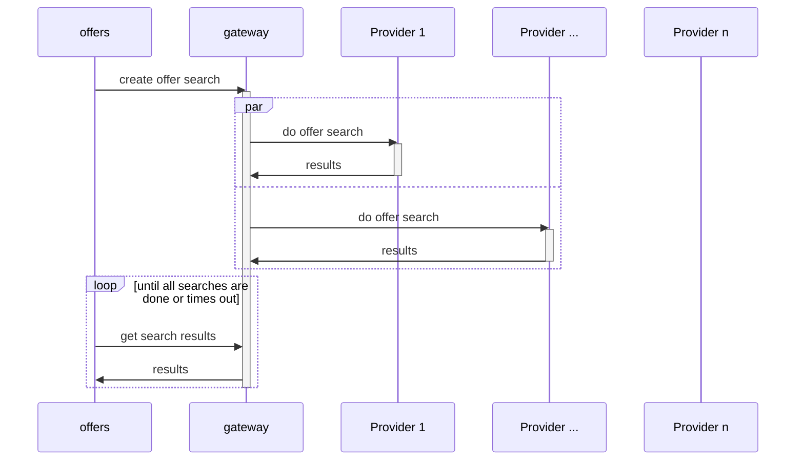
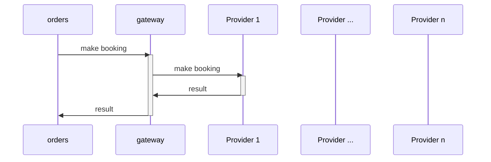

# Gateway

## Why?

The original problems that we needed to solve with providers was:
* Services that need to use a provider should not be required to have
  knowledge of all providers.
* A third party should be allowed to bring in their provider.

The original approach was to use AMQP to have providers "register"
themselves by connecting to a common exchange, so they got their own queue
of messages.

So originally the offers service publish one message to  AMQP, which then all
providers received. They then published results back to AMQP which the offers
service collected.

We then got a requirement to be able to track the status of an ongoing offer
search, which required us to add what we called "trackables", basically having
every consumer report back to the producer when it started processing a message
and when it failed or completed the task.

This turned out to not be a good approach, as we basically tried to use an
asynchronous communication method synchronously.

It was also clear that this was hard to test and debug, since we had to
interact with AMQP to be able to communicate with a service, and you had to
run a service or script to produce the messages, because they were packed
binary messages. The lack of a clear API interface for a provider also added
to the confusion. It was not clear how to implement functionality.

A further issue was that while it felt relatively logical that an offer
search message reaching every provider, it was much less logical that even
requests for creating bookings reached every provider, when what we actually
wanted to do was to call a specific provider we had already been in contact
with previously.

We decided to run a gRPC server in the providers, but we still had to solve
the original problem, we do not want every service that wants something from
a provider to have to be configured with its address.

That problem could be solved with a service who's main responsibility is to
know which provider or providers to call for a specific request, what we
have come to call the gateway service.

How is this improved by using the gateway?

Notice that it's not necessary for the gateway to call every provider. This
was something that could not be controlled previously.

It's also even more clear how easy this is when it comes to communication
with a single provider, like when placing a booking:

