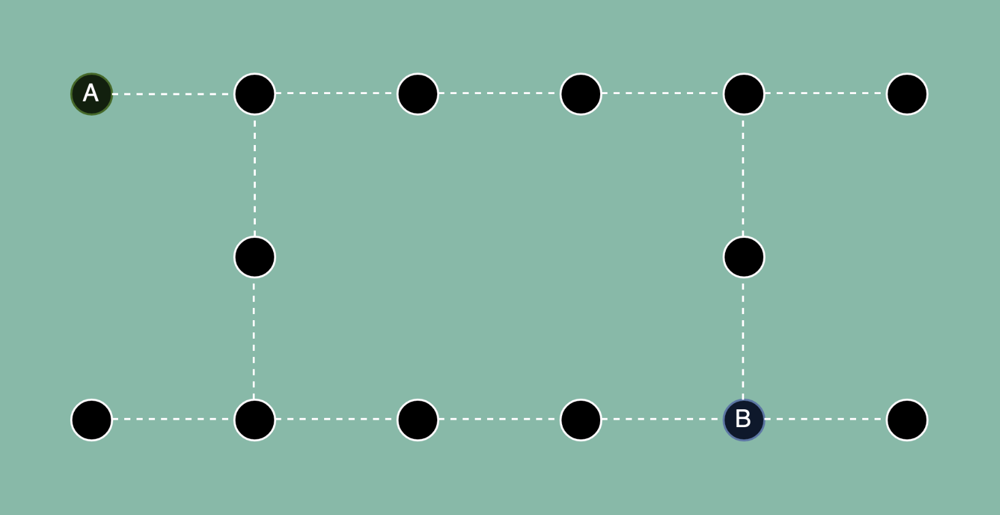
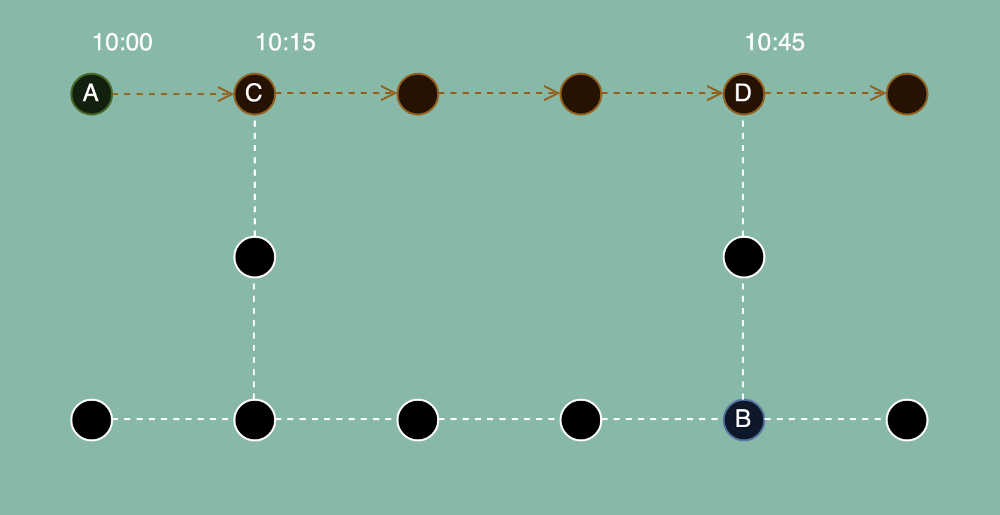
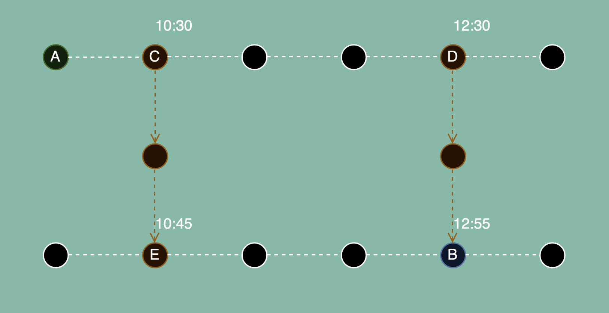
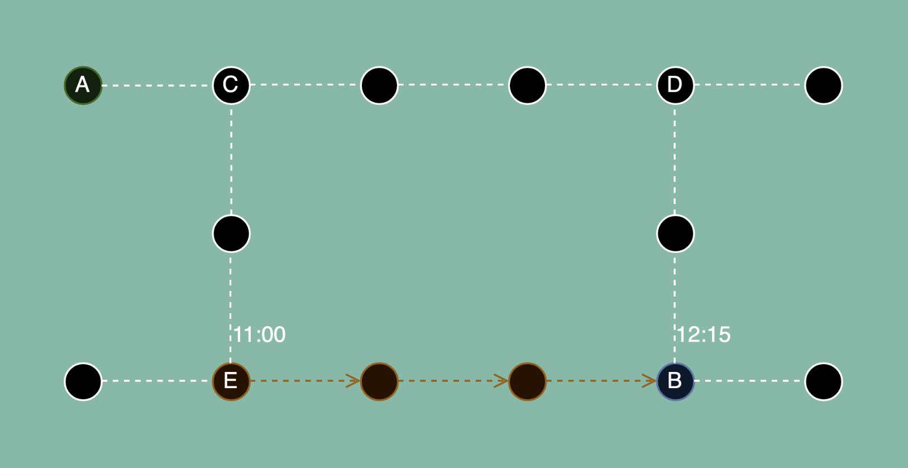
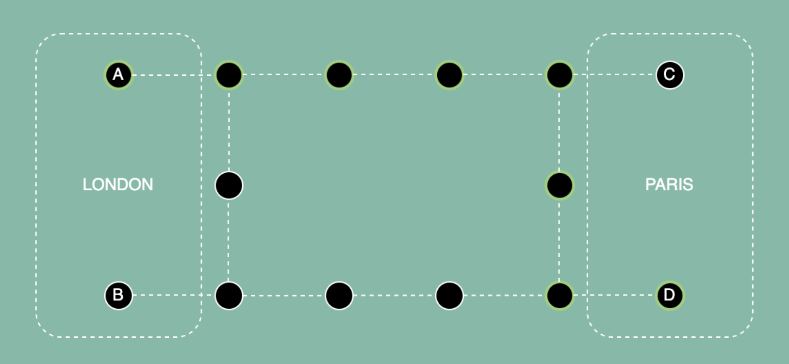

# Journey Planner

### Knowledge Fest Topic 🤘

These docs were based on the Knowledge Fest talk `@jyggen` gave.

You can find the recording here: https://snowfall.zoom.us/rec/share/s78VXaAja8hOpG8sytMhw6GMTSnAopDz0aOq2D47fvBBqChsNeBfBatNhK70BCxL.y__YIvfKScpLt7oM

## What is the Journey Planner?

Journey Planner (Commonly referred to as 'Planner') is a service which given your requirements, will
tell you the most efficient way to get from A to B.

## How does Planner plan journeys?

Planner uses an algorith called [RAPTOR](https://www.microsoft.com/en-us/research/wp-content/uploads/2012/01/raptor_alenex.pdf)
(Round-Based Public Transit Routing) to find how to get between Point A and B.

## What does RAPTOR need?

To be able to plan your journey between A and B, RAPTOR needs to know where and
when you can travel using one or more modals of transport.

This data is provided via [Schedules](./schedules), which are compiled down into the minimum necessary data that RAPTOR needs to build its graph.

## How RAPTOR graphing works

### 1. Specify A and B

Here we specify our origin (A) and our destination (B), which you can see are linked via various nodes.

### 2. Perform a round from our origin

RAPTOR marks nodes that can be reached without transfers from A, with _when_ you will arrive there.

From A, without transferring for example, you can arrive at C at 10:15 and D at 10:45. These times are remembered
and then in subsequent rounds we see where we can get to from these nodes.

### 3. Perform rounds from our newly remembered nodes

RAPTOR then marks nodes than can be reached without transfers from C and D.

From C, we can get to E and arrive at 10:45, leaving at 10:30, from D we can get to B and arrive at 12:55, leaving at 12:30.

We've reached our destination of B, so we know for sure that we can there, with one transfer, by 12:55.

However, we also know that E still has a way to get to B, and given E has an arrival of 10:45, there is potential still to get to B earlier.

### 4. Perform rounds till we have exhausted routes to our destination

RAPTOR completes rounds by marking where we can get to E from without transfers.

We can see that if we leave E at 11:00, we can arrive at B by 12:15, which is earlier than our first full A to B route.

Between rounds, RAPTOR also sees what nodes are transferable by foot,
which might mean you can make a journey that gets you to your destination even earlier.

## Improvements to RAPTOR for GO

Whilst RAPTOR does indeed find the quickest route from A to B, there are a few additions we've added to make it
even more useful for GO.

### rRAPTOR

rRAPTOR (Range-RAPTOR) is an extension which takes the departure of the earliest result, adds a minute to that departure time
and searches from trips leaving at earliest at that time. This makes Raptor skip the best trip it already found and finds the
best trip after the first one. And then it continues like this until it reaches a cutoff which is ~4am the next day.

This gives us the set of the best journeys throughout the day that a consumer can make.

### Parallelization

The original RAPTOR algorithm sequentially addresses node traversal, we've parallelized this so that for scenarios like [Point 3](journey-planner#3-perform-rounds-from-our-newly-remembered-nodes)
we can analyse both C **and** D at the same time, rather than C **then** D.

### Minimum Connection Time

By default, RAPTOR doesn't have a minimum connection time. If you arrive at an Airport at 12:00, RAPTOR will happily give you a connection to make at 12:01 :sweat_smile:.

To combat this, we've added prefixes and suffixes to different modes, so that if you arrive from W mode, you will need X time, but if you're using Y mode, you'll need Z time to get there.

This aims to give the traveller enough time based on where they're going and where they've come from.

### Multiple origins and destinations

By default, RAPTOR only works on one origin and one destination, if you're looking for London -> Paris, this can be problematic, there are many nodes that represent these places.

To combat this, we provide RAPTOR many origin and destinations that represent A and B, it will then find the quickest arrival between all the origins and all the destinations.

Below is an illustration of this, RAPTOR isn't trying to get you from the center of London to the centre of Paris, it is trying to get you from London to Paris the quickest.

There are multiple origin and destinations, B and C may be central in the cities, but they won't give you the earliest arrival in Paris if you travel via them.

## Pain points of RAPTOR

RAPTOR worked well in proof of concepts, but some issues have appeared:

* Memory Usage - RAPTOR takes a **lot** of memory, it is expensive to run on compute
* Data needed - Generating the data RAPTOR needs takes a lot of time
* Dependency on schedules - If we don't have schedules, we don't know where and when we can travel
* Provider anomalies - Planner sometimes returns results that simply don't match what Providers _now_ offer, due to drift in schedule data

## Looking ahead (Recommend, don't Dictate)

We are currently looking into Route-based offer searching; right now, we try to match what planner returns **exactly** with what our Providers offer.

Route-based means we find routes (Can I get from A to B), rather than trips with exact timings. We request all results from A to B from providers _then_ use RAPTOR to
recommend which of those offers we should provide, as these will be the most efficient based on various criteria we can define.

