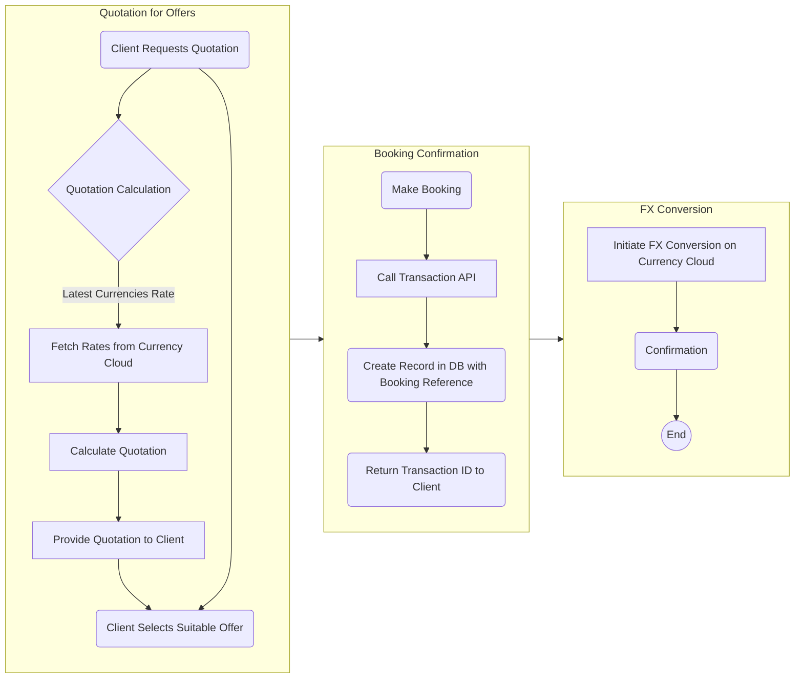

# Pay Integration Flow

so lets explain the Go - Pay integration process below.

* **Client Interaction:** This subgraph represents the interaction between the Go and the Pay system. It starts with the client requesting a quotation, followed by the quotation calculation, fetching rates from Currency Cloud, calculating the quotation, and providing it to the client. The client then selects a suitable offer.

* **Booking Process:** This subgraph handles the booking-related steps. Once the client selects an offer, the booking is made, followed by a call to the transaction API by GO. on receiving the request a record is created in the database with a reference to the booking, the reference is sent back to Go for future reference and autdits.

* **FX Conversion:** This subgraph focuses on the foreign exchange conversion process. It begins with the creation of the booking record and then proceeds to initiate the FX conversion on the Currency Cloud platform. Finally, the process reaches the confirmation stage and ends.
