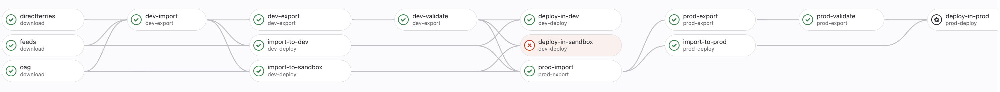

# Schedules

### Knowledge Fest Topic 🤘

These docs were based on the Knowledge Fest talk `@sam.b` gave.

You can find the recording here: https://snowfall.zoom.us/rec/share/PIER-unOxKmxQktndy3V8FVblC7AV1raU8RrX9mW16BN_tbyK7lpnL3Es_YHRmfV.2C_WUPpcXa1I22H6?startTime=1694784854000

## What are Schedules?

Schedules are timetables of when a mode of transport (flight/rail/etc) arrives and
departs from a location.

## Why we need Schedules?

Within Planner, we use Schedules to determine routes between locations that are
viable, given the arrival and departures of the modes of transports linking them.

## Where do we get Schedules from?

We currently have three main channels of Schedule data:

* [OAG](https://www.oag.com/) - Provides the majority of our Airline Schedules
* [Direct Ferries](https://www.directferries.co.uk/) - A special case due to their exposed APIs
* Feeds - Direct GTFS friendly sources from various providers (You can find the list of these under `junction/python/snowfall/project/junction/go/service/data_pipeline/datasets.json`)

## What is GTFS?

[GTFS](https://gtfs.org/) is `an Open Standard used to distribute relevant information about transit systems to riders`

## How do we get this data and where does it go?

The pipeline for Schedules looks like:

From left to right, the pipeline does the following:

* Downloads Schedule data from our various channels
* `dev-import` takes GTFS from the channels (or data that will be converted to GTFS) and converts them into a format for the database
* `dev-export` then takes this data and creates files that are used by Planner
* `import-to-dev` takes the files from dev-import and stores them in the dev database
* `import-to-sandbox` ditto in sandbox
* `dev-validate` performs some sanity checks on the data to make sure it's exported ok
* `deploy-in-dev` planner files are copied over, new tables are renamed to be the authoritative tables and old tables are renamed to be backups, and any other migration steps are complete.
* `deploy-in-sandbox` ditto in sandbox
* `prod-import` same as the dev and sandbox step but with the full set of data, whereas the formers are subsets
* `prod-export` same as previous, on a larger dataset
* `import-to-prod` same as previous
* `prod-validate` same as previous
* `deploy-in-prod` same as previous but requires manual SRE invocation
