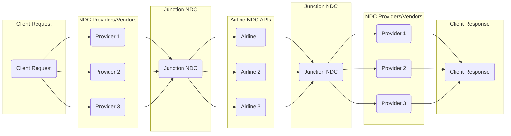

# Junction NDC

## Introduction
#### NDC - New Distribution Capability
NDC, an API standard by IATA (https://www.iata.org), streamlines direct connections between airlines and travel agencies, bypassing GDSs like Amadeus and Sabre.  This standard allows companies like Snowfall to easily access and  integrate with airline inventories, such as British Airways, enabling a quicker time to market for new airline inventory and services.

#### Junction NDC - https://git.snowfall.se/junction/snowfall-ndc
Junction NDC is a standalone repo that serves as Snowfall's internal NDC API to which NDC airline provider services make their API requests. The Snowfall NDC API then routes the requests to the relevant Airline NDC API, handle any differences between providers and translating both the requests and responses from JSON to XML and XML to JSON. Currently, only British Airways is supported.

## NDC API Request-Response Lifecycle Flowchart

