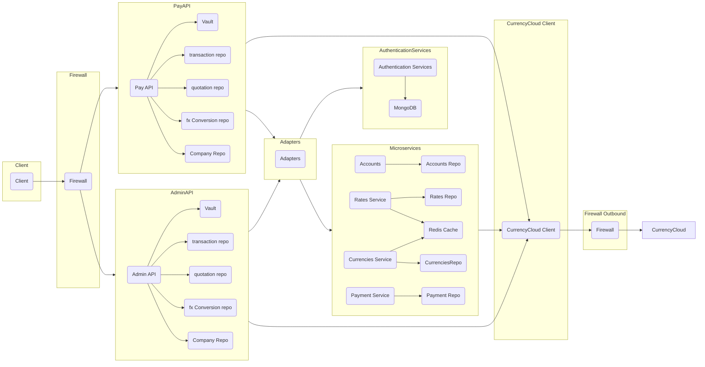
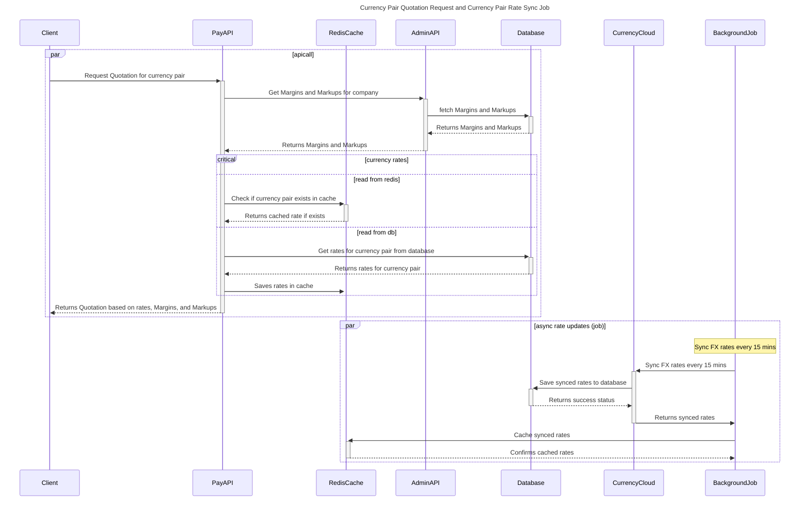

# Junction Pay

Junction pay System Flow Diagram

In this flow diagram

* The Client (A) communicates to Pay and admin API via inbound Firewall (B).
* The Pay API (C) retrieves secrets using the Vault (E) and will use quotation, transaction and fx conversion repos, this will be used by Go to create Quotations and Transactions.
* The Admin API (D) retrieves secrets using the Vault (E) and will use quotation, transaction and fx conversion repos. admin api will be used by Hub to list down quotations, transactions, and fx conversions
* The Adapters (H) mediate the communication between the Pay API, Admin API, Authentication Services, and the Microservices.
* The Authentication Services (F) have a connection to the User Repository (G).
* The Microservices include the Rates Service (J), Rates Repository (K), Currencies Service (L), Currencies Repository (M), Redis Cache (N), Accounts (O), Accounts Repository (P), Payment Service (Q), and Payment Repository (R).
* The Microservices interacts with the CurrencyCloud Client (S).
* The FirewallOutbound (T) represents the outbound traffic from the Firewall.

Quotation API:

This api will be consumed by clients to get the calculated amount based on currency pair. New amount will be calculated using the fx rates, Margins and Markups setup against the client's company.
below sequence diagram demonstrate the flow and components involved.

