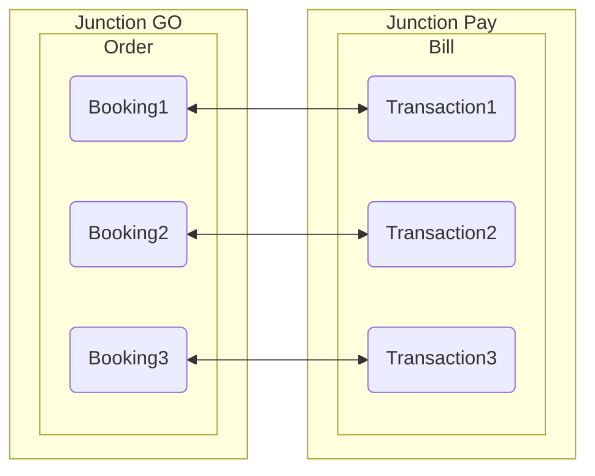
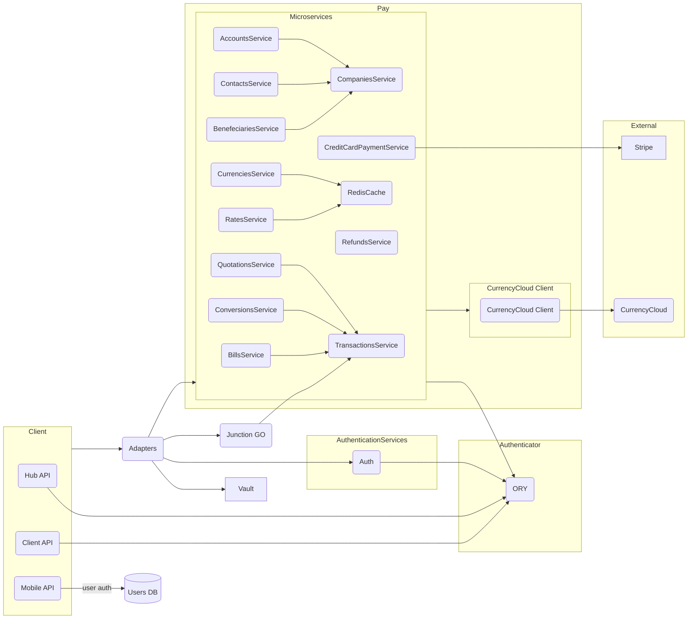
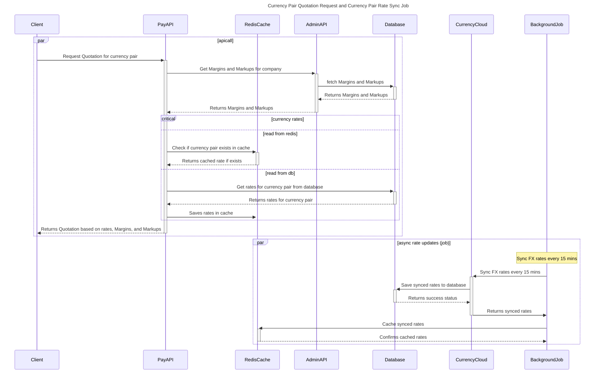
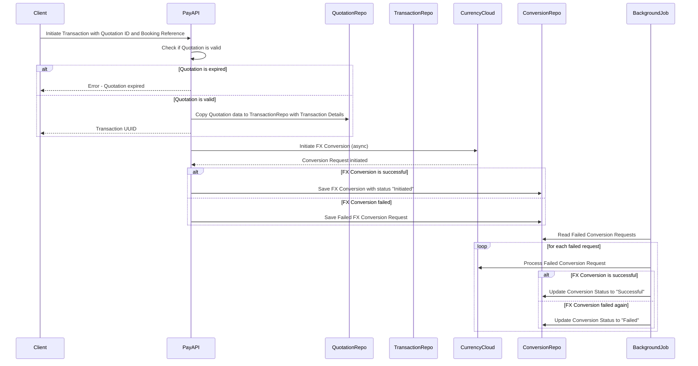

# Junction Pay

## Overview

Junction Pay is the Junction's clearing house and handles all finance-related responsibilities between all the participants in Junction marketplace (for eg. providers and resellers). It is a part of Junction Go, and exposes its functionality over gRPC.\
Resellers can order based on their multi-modal travel offers they have received from Snowfall. This would be a single-payment per order. Each Order is a bundle of Bookings from various providers (as it could be multimodal travel) and also potentially other services. Snowfall maintains commercial relationships with each reseller and each provider and is able to include details of previously-existing relationships between them within the platform configuration, as needed.\
So essentially Junction Pay enables smooth receiving, managing and settlement of funds.

## Vision

Junction Pay aims to introduce a modern fintech approach to settlements in the travel industry with smooth payments and low fees.
The guiding principle of Junction’s payment solution is to provide a secure, transparent and flexible platform with a modular services approach.

Reseller | Provider
--- | ---
Receive client funds in multiple currencies | No integration required
All transaction details in one platform | Minimal onboarding
Instant FX to lock in market rate | Single invoice per duration
Seamless payment of invoices | Receive single payment for multiple resellers
Maintain existing relationships | Invoice payable in multiple currencies
Automate admin overheads for accounts payable | No integration required

## Concepts

### Quotation

Junction uses the term *Quotation* for the potential pricing which could eventually change to actual payments. The currency used by the Provider and the Reseller could differ. In this case we would need to convert the Provider price from a particular currency to a Reseller price in their own supported currency. This would require FX rate comparisons and hence called a quotation, as it would be fixed but valid only for a certain time. This (Snowfall) Quotation will have Provider price plus added costs like FX margins, related taxes and expenses.
Each reseller will have a different configuration for the price calculation depending on different margins set for each. A Quotation is valid for 15 minutes from the time it has been created ans session tokens are used to keep the same value for the duration of the quotation validity.

### Transaction

A *Bill* is similar to what is an *Order* at Junction GO side.\
As an *Order* has multiple *Bookings*, similarly, a *Bill* has many *Transactions*. So a *Transaction* is similar to a *Booking*.

## Junction Pay System Flow Diagram

In this flow diagram

* The Client for PAY in this case is Hub API, Mobile API and Client API.
* The Hub-API get authenticated by ORY and Mobile API users get autheticated by the local database -> users.
* Once authenticated the clients can call the adapter to access the relevant Junction Pay gRPC microservice.
* Relevent  secrets are retrieved using the Vault.
* The Adapters mediate the communication between the Client, Authentication Services and the Microservices.
* Some of the major Microservices include services like the Company Service, Refund Service, Transaction Service, CreditCardPayment service, CurrencyService and the Rates Service .
* The Microservices interacts with the external CurrencyCloud via the CurrencyCloud Client.

Note: PayAPI and AdminAPI has been deprecate. Admin API has been moved to Hub.

### Fetch Quotation API

This api will be consumed by clients to get the calculated amount based on currency pair. New amount will be calculated using the fx rates, Margins and Markups setup against the client's company.
below sequence diagram demonstrate the flow and components involved.

### Create Transaction API

