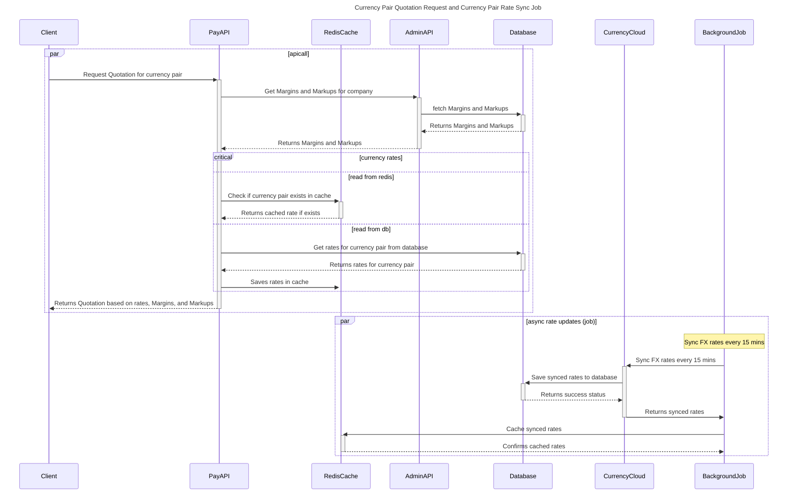

# Junction Pay

Quotation API:

This api will be consumed by clients to get the calculated amount based on currency pair. New amount will be calculated using the fx rates, Margins and Markups setup against the client's company.
below sequence diagram demonstrate the flow and components involved.

