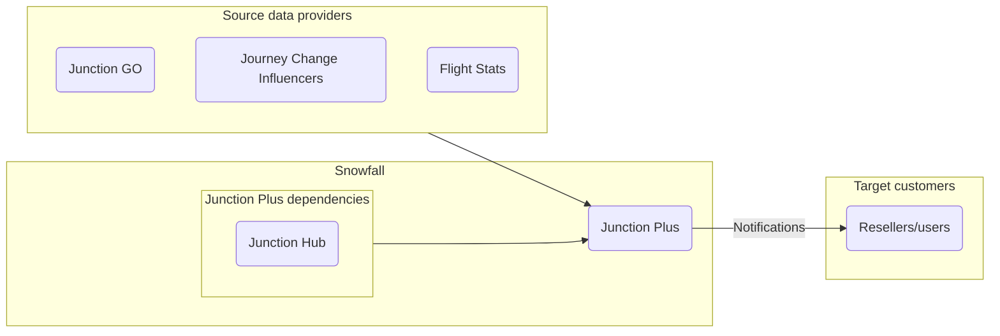
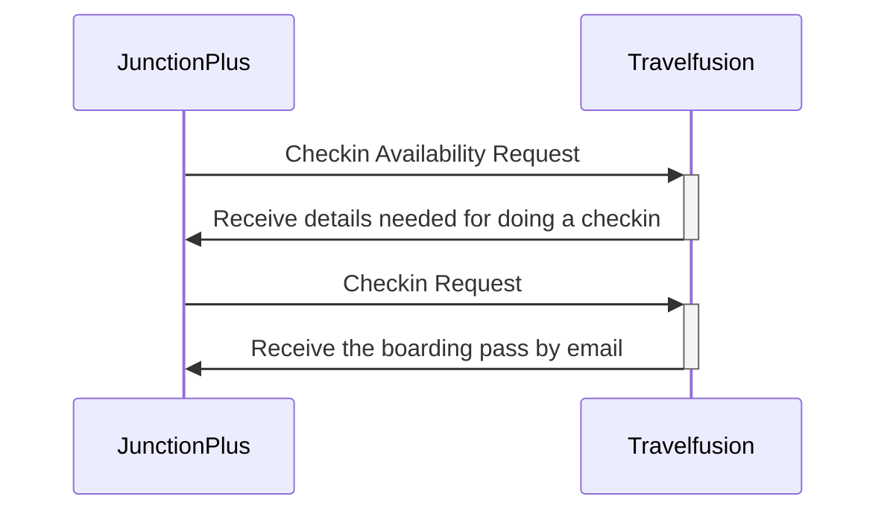
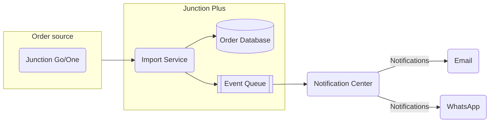
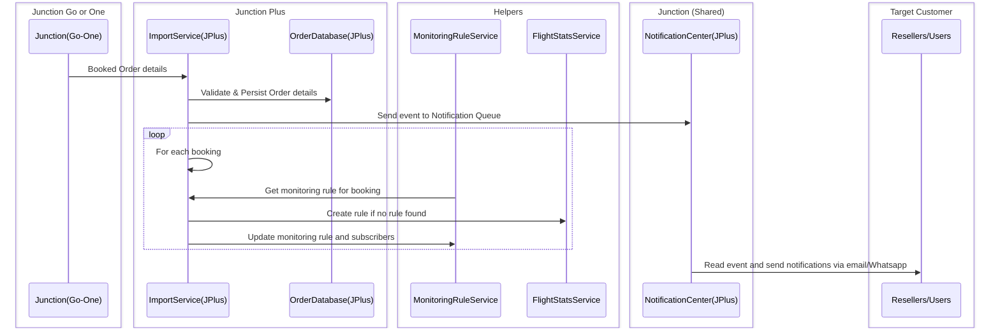
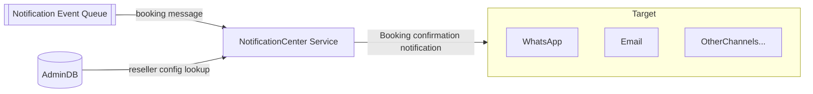

# Junction Plus

## High Level Overview

This is very high level overview of how Junction Plus interacts with the various other systems and system components, both - internal and external.



In the above diagram, there are 3 main system components - Source data providers, Snowfall Systems and the Target customers.

**Source data providers:** comprise of Junction GO which has aggregation of provider data, FlightStats which provides flight status information and Journey Influencers such as Weather, Schedule changes, Traffic disruptions, etc..

**Snowfall Systems:** encapsulates Junction Plus and Snowfall's internal dependencies like Junction Hub.
Junction Plus collects the data from Source, processes it with the help of its dependencies and eventually sends the relevant notifications to its Target customers.

**Target customers:** are the resellers and/or users

---

## Details

### Interactions with TravelFusion

*NOTE: This functionality was done as a part of POC and awaiting its time to be put into the product in a proper slot.*

There are 3 main interactions that happens between Junction Plus and Travelfusion. They are:

**CheckinAvailability request:**  To start the check-in process, Junction Plus makes a request that will return all the information needed to carry out a check-in operation, for a particular route. If check-in is not available  or could not be done at that time, then Travelfusion will respond accordingly. The details received will also include the time window when the check-in will be open.

**Checkin request:** Junction Plus will send all the information needed as per obtained from the previous step. This data will be saved against the check-in at Travelfusion side. If all the details are not available, some of the details can be provided (sent) later but it should be updated before the check-in opens.

**Receive the boarding pass with email:** Travelfusion will send the boarding pass/es in an email that was mentioned  as a UserParameter in the 'emailto' field.



---

### Order Registration

When a booking source (JGo/JOne) books a ticket:

* JPlus will capture that
* JPlus will persist the aggregated order into a database collection.
* It will then create a notification event.
* The Notification Center will read that event and send the booking confirmation message using the proper channel to the target customer (resellers/users)

There are message templates that will be used for the 'order registration request' and 'notification event request'



**Sequence Diagram:**



---

### Notification Center and WhatsApp implementation for Booking confirmation

The notification center is a central service which will read the *'notification_events_queue'* queue. Then it will look up the right channel and sender information from the *notification_configuration_vector* table in Admin DB.
The notification_configuration_vector should contain the following field:

```json
notification_configuration_vector
{
  _id: "",
  reseller_id: "",
  default_communication_channel: Enum[Channels],
  mobile_phone: "for whatsapp",
  email: "for email",
}
```

When we have a notification event in the queue, we will receive the notification from WhatsApp with the right message template. Message will be about booking confirmation:\
*"Dear [user name],\
We are pleased to confirm that your trip from **[Origin]** to **[Destination]** on **[dd, mm, yy]** is booked!\
**Booking Reference:** [booking reference]\
To check your trip details, please click the **“Trip details”** button below.\
To do auto check-in, please click **"Auto Checkin"***

**Diagram:**


