# Junction Plus

## Introduction

Junction Plus provides the traveller with continuous support throughout the entire journey. From the start of exploration, through the journey until returning back home. A virtual travel assistant constantly by traveller’s side providing proactive and reactive support and offers - In Tune on Time.

By constantly knowing and monitoring what the traveller has stored in their Journey Container, what additional content Junction has available and factoring in our data models, combined with personal knowledge and external metadata, the Junction platform can provide the below key features, all tightly interconnected. This is what comprises - Junction Plus.

* Automation - performing otherwise mandane and manual steps.
* Notifications – journey related information like changes, delays and cancellations
* Additional offers – supplying offers which could enrich the journey both in advance and on the spot

## High Level Overview

This is a very high level overview of how Junction Plus interacts with the various other systems and system components, both - internal and external.

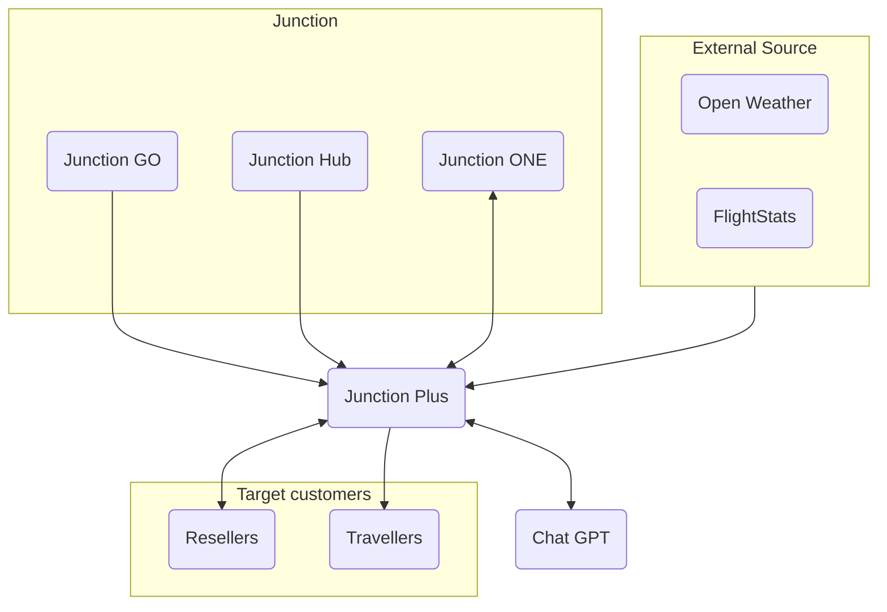

In the above diagram, there are 3 main system components - Source data providers, Snowfall Systems and the Target customers.

**Source data providers:** comprises of Junction GO which aggregates provider data, external applications like for instance, FlightStats which provides flight status information and Journey Influencers such as Weather, Schedule changes, Traffic disruptions, etc..

**Junction:** encapsulates Junction ONE, GO and Hub
Junction Plus collects the data from Source, processes it with the help of its dependencies and eventually sends the relevant notifications to its Target customers.
Junction Hub is mainly responsible to provide configuration related information to Junction Plus.
Junction GO provides details like bookings, etc.
Junction ONE can query for services that Junction Plus provides.

**Target customers:** are the resellers and the travellers who get the travel related notifications and other services.

**External Sources** are the external specialised data providers such as weather information obtained from OpenWeather APIs and  and Flight Stats for flight change status notifications.

ChatGPT powers the  AI features utilized via the Travel Assitant (chatbot)

**Third Party Helpers** are the external specialised data providers such as ChatGPT for AI features utilized via the Travel Assitant (chatbot), or weather information obtained from OpenWeather APIs.

---

## Details

## Integration with FlightStats

### Order Registration

When a booking source (JGo/JOne) books a ticket/passes information of a booking, to Junction plus:

* The booking event message is put into a Notification Broker (AWS MQ for Rabbit MQ). It has the routing key set to indicate it is 'order related for plus'.
* JPlus will capture that information.
* JPlus will persist the order into a database collection.
* It registers a webhook with FlightStats for certain events (like Cancel, Delay, Baggage location etc...). This registration is the monitoring rule which will have an id.
* When there is a flight related change, Junction Plus will gets an event trigger from FlightStats. The alert that is received from FlightStats mentions the flight related change and also monitoring_id. Using the monitoring_id Plus can find all the subscribers.
* Junction Plus will then create a notification event for the subscriber. This notification event will be put back into the Notification Broker but with a differnt routing key. This key will indicate it is for notification.
* The Notification Center will read that event and send the notification using the proper channel to the target customer (subscriber/users)

**Diving deep:** The Webhook service will handle the triggers from FlightStat. This is a listener service that listens for an alert from FlightStat.

*How does it handle the alert:* This Webhook service will get the rule id in the alert; and then look up all the subscribed passengers for the orders related to that rule id. For each subscribed passenger it will send the relevant notifications to the Notification Broker with the appropriate routing key.\
The message will filter through the Exchange to the appropriate notification queue. The 'Notification Center' will read the message in the queue and then check what channel is this notification to be sent by. If such a channel exists, then the notification center will call the function as per the notification alert type.
for. eg. it is a FlightStats notification to be sent via whatsapp, then the notification alert type would be TYPE_FLIGHT_STATS_ALERT and there should be a channel for whatsapp. Also there should be a function named 'flight_stats_alert' in the 'whatsapp channel' class. This function will be called and it will be passed the following parameters - NotificationEvent object, Subscriber object and ConfigurationVector object. \
Depending on the use case (alert type) a customised message is generated and sent to the appropriate subscriber whatsapp number.

Some of the FlightStats alert that are handled are:

* Gate change
* Delay in departure
* Terminal change
* Flight diverted
* Location for baggage pickup changed

Similarly, there are message templates that will be used for the 'order registration request' and other 'notification event request.

**Flowchart Diagram for FlightStats alert processing:**

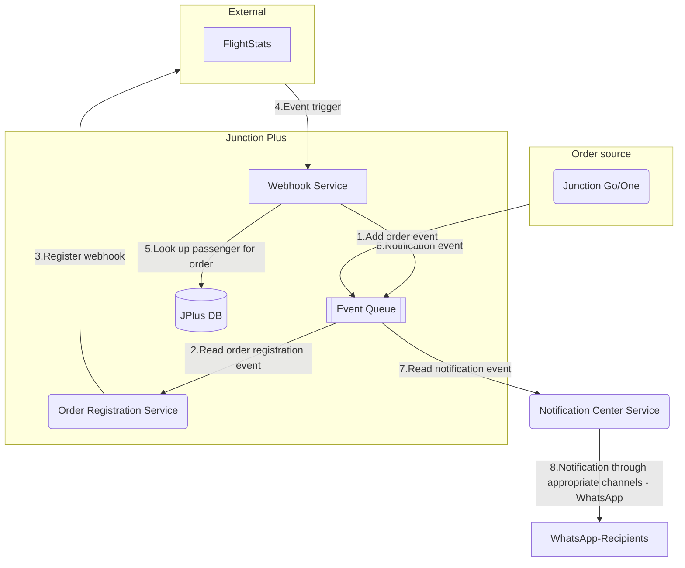

**Sequence Diagram for FlightStats alert processing:**

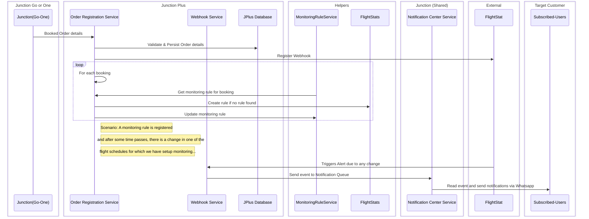

---

### Notification Center and WhatsApp implementation for Booking confirmation

The notification center is a central service which will read the *'notification events queue'* queue. Then it will look up the right channel and sender information from the *configuration_vector* and *subscribers* collection in database.

The Notification event message will be read from the queue by the Notification Center. It will examine the channel identifier, check if that channel is supported and then call the function derived from the event type. for eg. if the Event Type is TYPE_ORDER_CONFIRMATION the a function 'order_confirmation()' should be available in the required channel implementation file (say whatsapp.py). So in this use case, the function order_confirmation() will be called and will handle the part to send  the notification to the subscriber's WhatsApp number with the right message template. Message will be about booking confirmation:\
*"Dear [user name],\
We are pleased to confirm that your trip from **[Origin]** to **[Destination]** on **[dd, mm, yy]** is booked!\
**Booking Reference:** [booking reference]\
To check your trip details, please click the **“Trip details”** button below.\
To do auto check-in, please click **"Auto Checkin"***

**Diagram:**
**Flowchart Diagram for Order registration notification:**

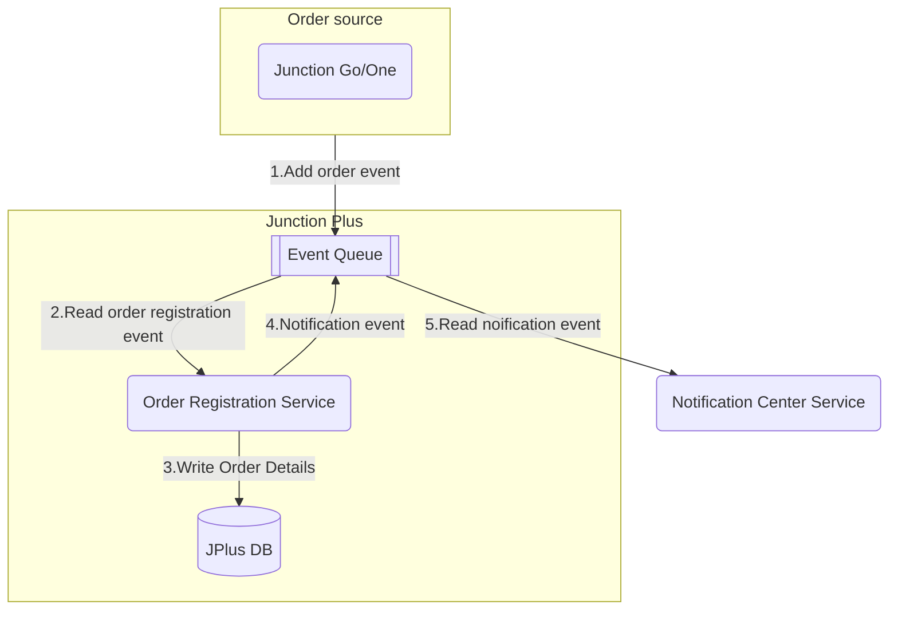

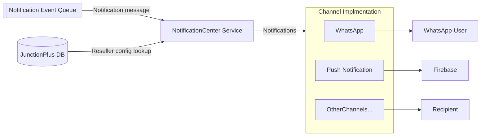

### Checkin alert

Currently the checkin alert is implemented for a few (10 to be exact as on 23/10/2023) airlines. i.e. if the user has booked a flight in these supported airlines, they are alerted with a notification message (thorugh WhatsApp) when the checkin window opens. In case of non-supported airlines, the users would be alerted 24 hours in advance of the flight departure time.

There is a new gRPC service (CheckInService) which is created which runs a cron job. This cron job is scheduled to run once per hour, every hour, around the clock, every day of the year. There is a list of lookup data which has the airline code against airline url and checkin window start time. This cron job runs according to schedule and for each upcoming flight booked, it retreives the airline code it checks it against the lookup data. If the checkin window for that flight has opened then it  generates the checkin message. This check-in message has the airline checkin url (if that airline is supported). If the airline is not supported then a generic 'checkin is open' alert is generated. This message is sent to all the subscribers who are associated with this flight,  via the notification channel. Once the notification is sent, mark it so that then next schedule of the cron job does not send the check-in alert again.

### Weather Report

Similar to check-in alert, a weather report is sent to the passenger. This is implemented as a scheduled service which runs every hour. Again the list of bookings is looked up to check which flights are due in the next 48 hours. If so then a 3-day weather report is generated for such destination. This weather report is sent to all the subscriber's (passengers for that flight) via the chosen chanel (currently WhatsApp). \
If the trip has multiple legs then only the final destination is considered and the intermediate stop-overs are skipped. for eg. if user has flight Yerevan -> Athens -> London and Athens is just a transit point (with layover less than 12 hours) we will not providing weather report for Athens (when cron checks Yerevan -> Athens flight)
but user will get London weather when cron will check for Athens -> London flight.\
Once the notification is sent, it is marked it so that then next schedule of the cron job does not send the weather report again.
The message has a preformatted structure and the message is formated as per the various weather conditions. for eg., it has details like Date, Hihest temperature, lowest temperatue, forcasted weather (icon).

***Note: Both Check-in service and Weather Report service send the notification event to the Notification Broker. After this the same notification process continues for choosing the notification channel and sending it to the recipient, as the order confirmation or flightstats alerts.***

---

## Integration with WhatsApp ChatBot

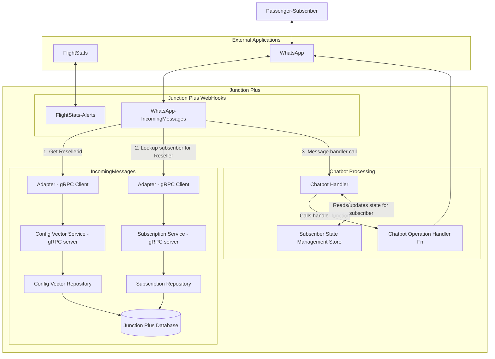

There are webhooks which listen for communications from external sources like, FlightStats (For flight info changes) and WhatsApp (for WhatsApp chatbot).

When the message comes in from WhatsApp, it is routed to WhatsApp->IncomingMessage class. The following process initiates:

* The message is read and categorised into 'To', 'From' and 'Body'
* Using the 'To' data (mobile number of reseller) the resellerid is read from the configuration vector.
* Using the resellerid, the subscriber is obtained from the database.
* The message is then sent to the Chatbot handler to handle the message.
* In the Chatbot handler:
  * Using the subscriber id, the subscriber state is retrieved from the state management
  * There are specific handler functions for specific message actions like subscribe/unsubscribe/etc. Depending on the message, appropriate handler is looked up and called to handle the message
  * As per the latest call to the message handler, the new subscriber state is created/updated in the State Management Store. i.e. For each use case, a redis hash (collection) is created and the key-value pair info is stored in it. For eg. In case of 'booking confirmation' a hash is created 'message_id_order_id' (twilio message id and order id) and then a key (message id) and value (order id) is stored in it, for each booking. So given a whatsapp message id the appropriate booking/order information can be retrieved and returned.

### The Flow of Menu Options in WhatsApp

* On new Booking -> **Booking Confirmation Message** is sent to the user which has **Trip Details** link
* **Trip Details** link -> shows Trip Details
* **Main Menu** (Twilio/call-to-action) has\
-> **Upcoming Trips**\
-> **Travel Assistant**\
-> **Unsubsribe**
* **Upcoming Trips** -> List of Indexed Trips. (In case more than 1 trip is booked)\
User choosed an index (1 for first trip, 2 for second, and so on...) -> Displays Trip Details
* **Unsubscribe** -> to unsubscribe from getting notification on Whatsapp
* **Subscribe** -> To re-subscribe to get notification messages on Whatsapp

### Travel Assistant - Integration with AI (chatGPT 3.5/4.0)

If the user does not select an option provided in Whatsapp, for eg. 'Upcoming Trips, Unsubscribe' etc, or selects 'Travel Assistant' then this selection is taken up by a 'Travel Assistant' handler.

In this handler: A state management is created for AI(Travel assistant) session in the redis cache for that subscriber if the AI is enabled. This will have a dictionary (mapping) which contains the instructions for AI to setup the context of the conversation; and the initial message provided to the user to start the conversation. This forms a part of AI setup.
The state will also contain the conversations i.e. all the messages between the user and AI. All the conversation messages will have to sent back and forth between user and AI (LLM) so that AI has all the context to give an effective and sensible response.
Once the user is happy with the conversation and opts to end it, then the state (context of the conversation) is deleted so that the conversation topic can be changed.

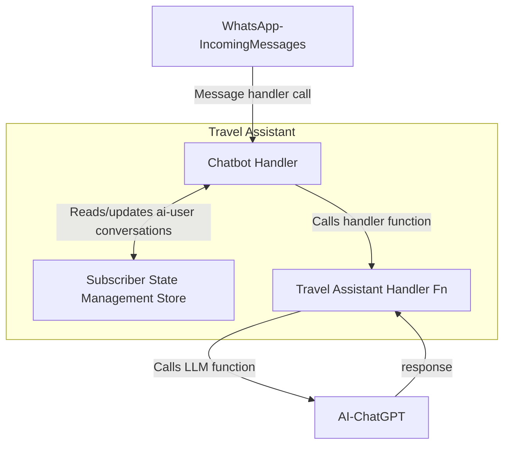

#### Note

We have used the official openai library and the async function ChatCompletion.acreate. Focus was on creating the right system prompt in order to give the initial instructions to the GPT model. Also if the recommendations provided by the Travel assistant (AI) is about place or activity then the system message instructs it to always include url for the same. This would help user quickly check the recommendations.
We used the official playground for testing. The chat history must remain cached per user as it will be used as input for the next message as the point is to build and send the entire conversation. When the user selects Travel assistant, the ai assistant will be enabled and any new incoming message ,if it doesn't fit to the predefined functions, will be prompt to openai. When the user gets the requested info for 1 destination, the conversation should be terminated and the system will reset the user's cached history, disable the travel assistant and send the 'Home' message. In order to distinguish the end of the conversation, we create a custom function and instruct the model (through the system prompt), to call that function only when it understands the completion of the task, so we can use it as a trigger point.

### You could book flights  on RES via travel assistant/WhatsApp

There is a prompt in chatbot for 'Search Flights'. An equivalent function is available in the travel assistant (openai) handler which handles the formatting of the message to be sent to the reseller's website (RES).
his has at least 3 required params the Origin, Destination and Date. The reseller should have a customized url:str that will be able to format with those 3 params, shorten the link and send it as a response for the chatbot. 'api.short.io' is used to shorten the URL.
The reseller will input their url in the configuration vector. This is read and sent to the travel assistant (openai) handler function.

### Book or Search for a Flight

If the user using the Travel Assistant wants to book/search for a flight then they will be given a search url and they can search or book the flight following that link. \
The search URL is mentioned in the Configuration_Vector table and retrieved on the search flight or book flight command/option given by the user.

### Provide travel assistance for upcoming trips

The user could see the list of upcoming trips. When the user selects to view a specific upcoming trip X by typing an index number then the user can see the trip details of the upcoming trip X and they can see the following actions:

* Check-in
* Plan this trip
* Main Menu

When the user selects ''Plan this trip'' and the Travel assistant is enabled a message appears saying:
''Great! For Y (where Y is the trip destination of upcoming trip X), I can provide you with the following options:

1) Top 5 restaurants
2) I would like to spend a day here
3) Give me a 3 day itinerary

Please let me know which option you would like to choose or type your query regarding your trip.

**Implementation**:
There is a new function (plan_selected_trip()) in the chatbot_handler for the chat bot menu option 'Plan this trip'. This function is passed the message_key as the parameter. It stores the key for the 'message_id_order_id' session in redis cache. Gets the order_id using the message_key from the redis cache. Retrieves the 'AirBooking' from the bookings in the order and compresses it. i.e. now it has the origin and final destinations.
It then gets the chat history from another redis cache session - ai_assistant_state. This is the context of the conversation. It then adds the destination airport as the message to initiate the conversation (asking to plan for that airport/city) and Sends the updated chat history to ai calling handle_prompt().
The AI then responds back with the planned activities for that city. The handler gets the response and return it back to caller (WhatsApp).

### Push travel alerts to any Reseller App

The following feature is to push any travel related alerts to any reseller app like the 'SuperApp'.

**Implementation**:\
**Setup**:\
There is an new in-app notification channel type created for push notification - Channel.CHANNEL_PUSH_NOTIFICATION: (similar to WhatsApp - Channel.CHANNEL_WHATSAPP). Also a new notification channel is created that will be used for sending push notifications to applications like SuperApp. The processing logic of creating the message (in push notification module) should follow the same implementation logic as for WhatsApp channel. Just the target should change so as to call the Firebase instance rathar than whatsapp/twilio-client.

The supported notification channels for a particular subscriber should be read from the configuration_vector. The 'Channel' key in the configuration_vector collection specifies all the supported channels for notification.

**Connection with Firebase:**
A new connection is established with Firebase. The app.settings file will have the Firebase (Secret) key. firebase_admin will provide the firebase credentials and firebase messaging support. firebase_messaging.send() is used to send the message to Firebase.

**Mobile API:**\
The Mobile API is updated for creating and updating the Notification Token - mobile api endpoint: /push-notifications/tokens.
The mobile API database will store the mapping for notification token, device token and userid.

The Mobile API will pass on the task of calling junction plus functions to a new plugin - plus client. i.e. The MobileAPI endpoint will call the new Junction Plus client and that in turn will forward push-notification tokens to Plus-API. Plus-API will use ORY for authentication to validate the caller.

**Plus Client:**\
The Plus client will call a listener service in Junction Plus - Plus-api.
A new infrastructure needed for the new plus api layer is built, including updates to\
BUILD: for entrypoint into the plus-api service,\
http.json: environment information,\
http.nomad: nomad details like docker image, network, scaling , service details, etc.
under nomad/junction/plus-api/

**Plus-API:**\
A new REST endpoint is created in plus-api (say /push-notifications/tokens) which will be called from the consumer (which in this case is the plus-client api  and which in turn is called from the Mobile API). This will be a PATCH call, and the body of the call will have the 'Notification token' and the 'mobile number of the subscriber'. The authentication will be done by ORY and you will get the reseller-id (authenticated token) in Request.user.username.
For authentication, the JWT token and Authentication address (ORY location) is updated in the env.dist file. Inside the main.py for plus-api the ORY authentication is setup in the middleware so that the incoming call is verified.

**Subscriber Service (gRPC):**\
Plus-api will call the Subscriber gRPC  service  to create/update the token for that particular subscriber.
Create new calls for Update and Creation of Push Notification in Subscriber (Repository) service.

**Diagram: SuperApp instance registers with Firebase**:

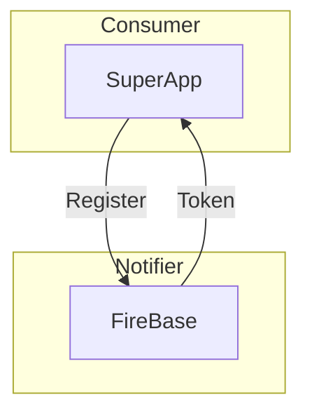

**SuperApp sends token details to JunctionPlus**:

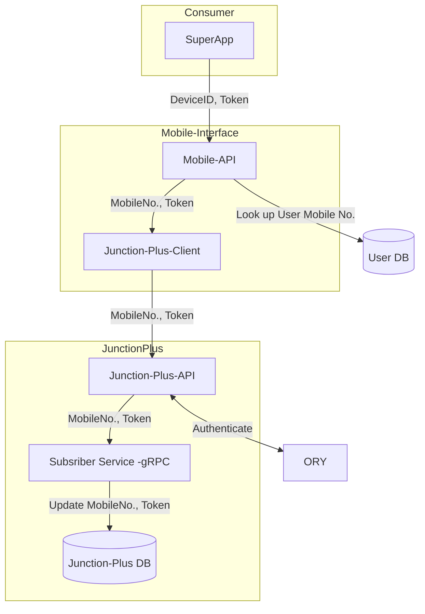

**Notification Mechanism**:

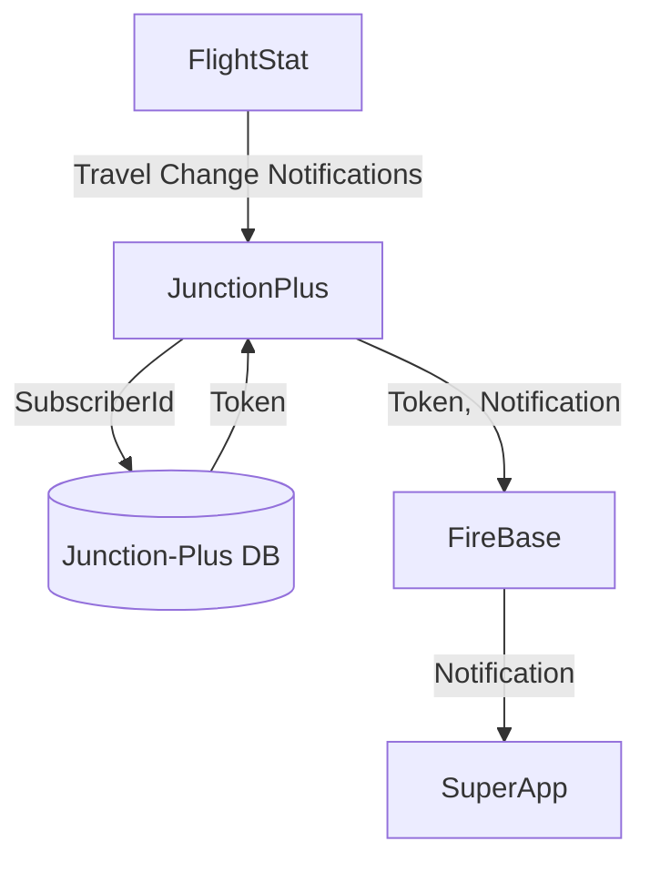

### Open Travel Assistant (chat-bot) to any App (SuperApp)

**Implement Matrix client:**
This will a webhook to receive communication from the Matrix home server.  'nio' is used as the backend python library.
In addition to the webhooks url, register another url for matrix_homeserver_url in traefik to act as a listener.
In the webhooks, start a new command for Matrix communication.

* Create a new redis client
* Create a new class for Matrix communication (MatrixChatbot) which has redis_client, subscriber_client, configuration_vector_client and ai_client.
* Call run_bot() to login to the Matrix homeserver and start the sync.

Implement ChatID encryption.

Create a Matrix client and establish connection with the Matrix home server, providing the Matrix homeserver URL and Token.

Register the 'callback' function in MatrixChatBot for certain events so that the homeserver can call this function when that event occurs in Matrix home server. The event could be an InviteNameEvent, RoomMessageText, etc..

Connect AI assistant and handle cache:
The message_callback() function would be called in case there has been an incoming message in the Matrix home server which gets directed to the Matrix client/callback. The parameters to the function will have details such room and event.
Get the session state from the cache - 'ai_assistant_state'. The session state cache has the conversation list for each room indexed within it.
Get the room id from the room parameter and then look up the state from the room_id index in  the session state. Then from each room conversation get the 'ai_chat_history'.
Append the new message to the ai_chat_history and

* put it into the cache.
* send it to the room with parameter such as room_id, message_type and content which will be the message.

Another callback for the event InviteNameEvent should be register say autojoin_room()
This function will be called when someone gets assigned a room. Thus this is a setup function for a user/subscriber.

* Get the session cache for "ai_assistant_state'.
* Create an ai_chat_history conversation prompts, with role and content (prompts)
* Create ai_chat_history as an object in state
* Put the key, value (room_id, state) in session cache.
* Send the ai_initial_mesage (initial setup prompt) to the room.

Update Matrix bot class with autojoin callback and structure. The callback gets the room_name and the room_id.

Note:
The room id is a random id that matrix is creating and we are using it for caching.
The room name is something related with the specific subscriber and we are using it to fetch subscriber
The user id is something we pick and it’s related with the specific reseller and we use it to fetch configuration vector. The configuration vector will have the username in the 'in_app_notification_user' key. You can pickup the reseller_id to identify the reseller from that document record.

#### Diagram

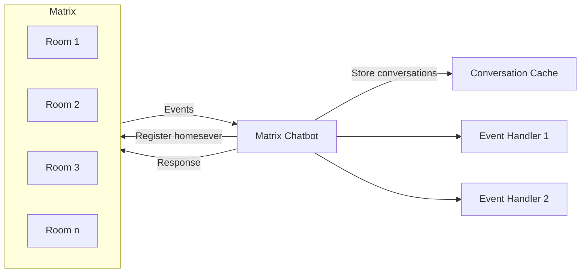
