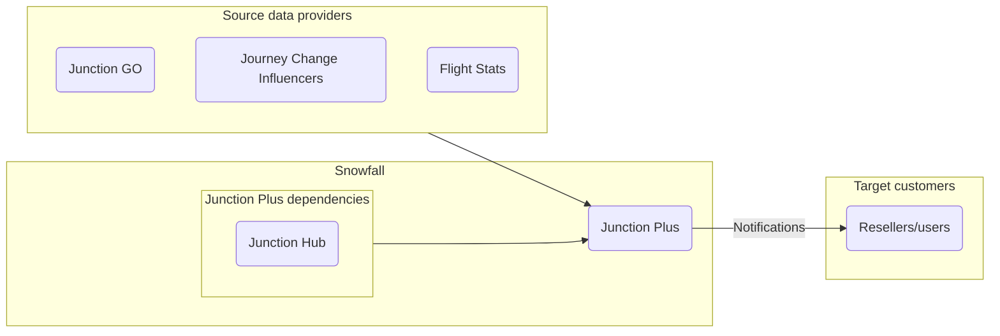
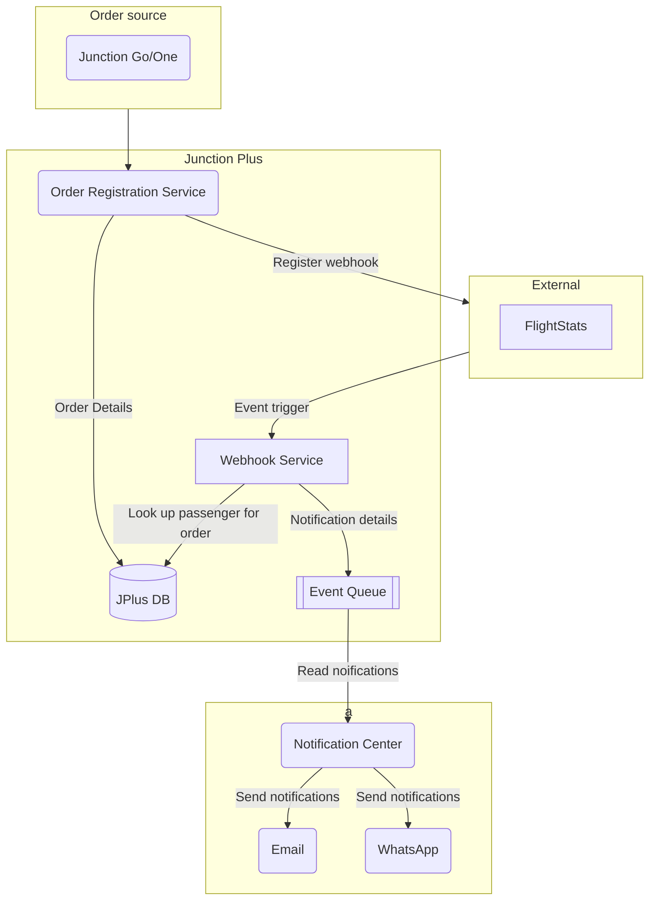
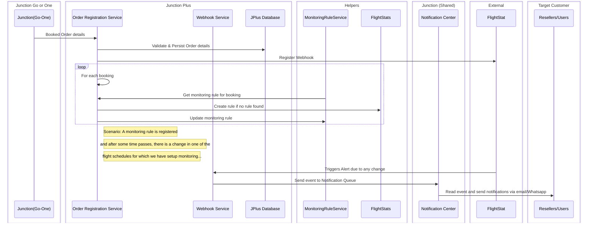
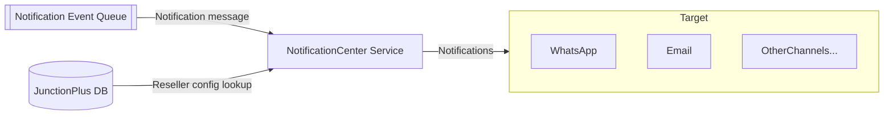
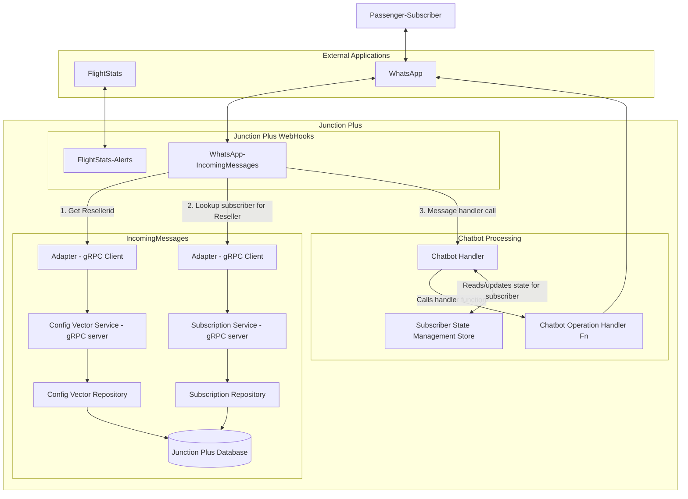
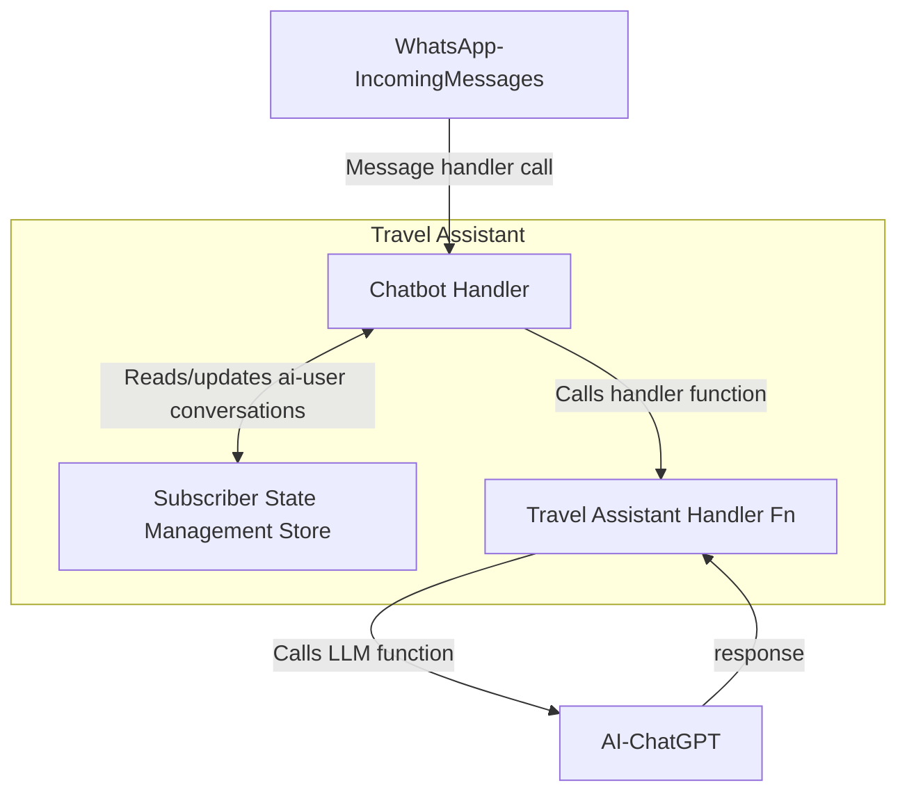

# Junction Plus

## Introduction

Junction Plus provides the traveller with continuous support throughout the entire journey. From the start of exploration, through the journey until returning back home. A virtual travel assistant constantly by traveller’s side providing proactive and reactive support and offers - In Tune on Time.

By constantly knowing and monitoring what the traveller has stored in their Journey Container, what additional content Junction has available and factoring in our data models, combined with personal knowledge and external metadata, the Junction platform can provide the below key features, all tightly interconnected. This is what comprises - Junction Plus.

* Automation - performing otherwise mandane and manual steps.
* Notifications – journey related information like changes, delays and cancellations
* Additional offers – supplying offers which could enrich the journey both in advance and on the spot

## High Level Overview

This is a very high level overview of how Junction Plus interacts with the various other systems and system components, both - internal and external.

In the above diagram, there are 3 main system components - Source data providers, Snowfall Systems and the Target customers.

**Source data providers:** comprises of Junction GO which aggregates provider data, external applications like for instance, FlightStats which provides flight status information and Journey Influencers such as Weather, Schedule changes, Traffic disruptions, etc..

**Snowfall Systems:** encapsulates Junction Plus and Snowfall's internal dependencies like Junction Hub.
Junction Plus collects the data from Source, processes it with the help of its dependencies and eventually sends the relevant notifications to its Target customers.
Junction Hub is mainly responsible to provide configuration related information to Junction Plus.

**Target customers:** are the resellers and/or users

---

## Details

## Integration with FlightStats

### Order Registration

When a booking source (JGo/JOne) books a ticket/passes information of a booking, to Junction plus:

* JPlus will capture that information.
* JPlus will persist the aggregated order into a database collection.
* It registers a webhook with FlightStats for certain events (like Cancel, Delay, Baggage location etc...)
* When Junction Plus gets an event trigger from FlightStats, it will then create a notification event.
* The Notification Center will read that event and send the notification using the proper channel to the target customer (resellers/users)

**Diving deep:** The Webhook service will handle the triggers from FlightStat. This is a listener service that listens for an alert from FlightStat.

*How does it handle the alert:* This Webhook service will get the rule id for the alert; and then look up all the subscribed passengers (Reseller/User) for those orders related to that rule id. For each subscribed passenger it will send the relevant notifications via the queue.

There are message templates that will be used for the 'order registration request' and 'notification event request'

**Sequence Diagram:**

---

### Notification Center and WhatsApp implementation for Booking confirmation

The notification center is a central service which will read the *'notification events queue'* queue. Then it will look up the right channel and sender information from the *configuration_vector* and *subscribers* collection in database.

When we have a notification event in the queue, the Notification Center will send  the notification to the subscriber's WhatsApp number with the right message template. Message will be about booking confirmation:\
*"Dear [user name],\
We are pleased to confirm that your trip from **[Origin]** to **[Destination]** on **[dd, mm, yy]** is booked!\
**Booking Reference:** [booking reference]\
To check your trip details, please click the **“Trip details”** button below.\
To do auto check-in, please click **"Auto Checkin"***

**Diagram:**

---

## Integration with WhatsApp ChatBot

There are webhooks which listen for communications from external sources like, FlightStats (For flight info changes) and WhatsApp (for WhatsApp chatbot).

When the message comes in from WhatsApp, it is routed to WhatsApp->IncomingMessage class. The following process initiates:

* The message is read and categorised into 'To', 'From' and 'Body'
* Using the 'To' data (mobile number of reseller) the resellerid is read from the configuration vector.
* Using the resellerid, the subscriber is obtained from the database.
* The message is then sent to the Chatbot handler to handle the message.
* In the Chatbot handler:
  * Using the subscriber id, the subscriber state is retrieved from the state management
  * There are specific handler functions for specific message actions like subscribe/unsubscribe/etc. Depending on the message, appropriate handler is looked up and called to handle the message
  * As per the latest call to the message handler, the new subscriber state is created/updated in the State Management Store. i.e. For each use case, a redis hash (collection) is created and the key-value pair info is stored in it. For eg. In case of 'booking confirmation' a hash is created 'message_id_order_id' (twilio message id and order id) and then a key (message id) and value (order id) is stored in it, for each booking. So given a whatsapp message id the appropriate booking/order information can be retrieved and returned.

### The Flow of Menu Options in WhatsApp

* On new Booking -> **Booking Confirmation Message** is sent to the user which has **Trip Details** link
* **Trip Details** link -> shows Trip Details
* **Main Menu** (Twilio/call-to-action) has\
-> **Upcoming Trips**\
-> **Travel Assistant**\
-> **Unsubsribe**
* **Upcoming Trips** -> List of Indexed Trips. (In case more than 1 trip is booked)\
User choosed an index (1 for first trip, 2 for second, and so on...) -> Displays Trip Details
* **Unsubscribe** -> to unsubscribe from getting notification on Whatsapp
* **Subscribe** -> To re-subscribe to get notification messages on Whatsapp

### Travel Assistant - Integration with AI (chatGPT 3.5/4.0)

If the user does not select an option provided in Whatsapp, for eg. 'Upcoming Trips, Unsubscribe' etc, or selects 'Travel Assistant' then this selection is taken up by a 'Travel Assistant' handler.

In this handler: A state management is created for AI(Travel assistant) session in the redis cache for that subscriber if the AI is enabled. This will have a dictionary (mapping) which contains the instructions for AI to setup the context of the conversation; and the initial message provided to the user to start the conversation. This forms a part of AI setup.
The state will also contain the conversations i.e. all the messages between the user and AI. All the conversation messages will have to sent back and forth between user and AI (LLM) so that AI has all the context to give an effective and sensible response.
Once the user is happy with the conversation and opts to end it, then the state (context of the conversation) is deleted so that the conversation topic can be changed.

